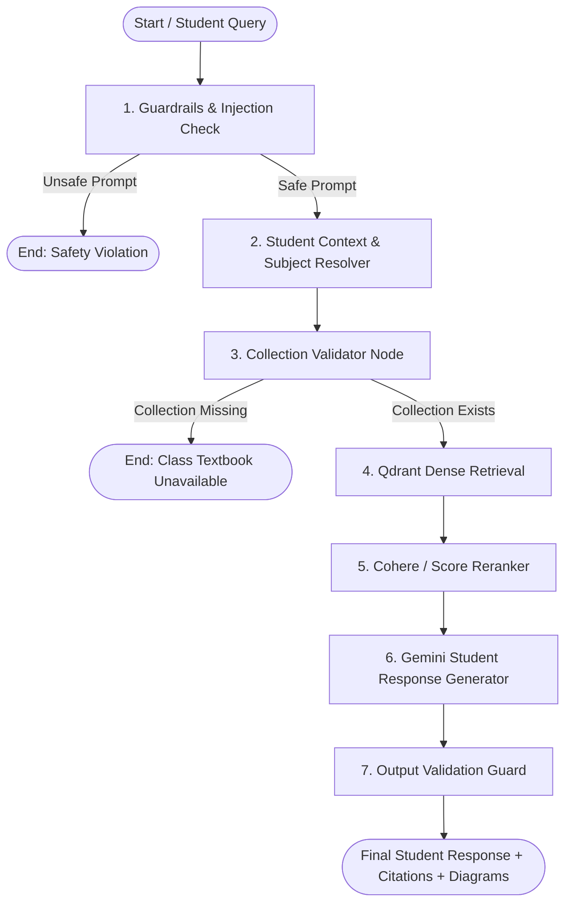

# Comprehensive Architecture & Implementation Plan:
## LangGraph-Orchestrated Multi-Standard, Multi-Subject Student Q&A RAG Agent

---

## 1. Executive Summary & Use Case Analysis

### The Goal
Build a dedicated **LangGraph Workflow Orchestrator** in Python inside `lms-book-ingestion` that acts as an intelligent, contextual School Student Academic Tutor. 

When a student asks any question from the UI:
1. The request supplies student context (**Student Name**, **Standard/Grade** e.g. `9` or `10`, **Subject** e.g. `math`, `science`, or user query).
2. The agent automatically **senses and routes** the question to the **exact Qdrant Collection** (e.g. `school_textbooks_class9` vs `school_textbooks_class10`).
3. If the subject is not explicitly selected in the UI, an intelligent classifier node detects the subject (STEM, Humanities, Language) directly from the student's question.
4. The workflow verifies collection availability, applies security guardrails, retrieves & reranks textbook chunks, and produces a pedagogical explanation with **LaTeX formulas**, **textbook citations**, and **diagram references**.

---

## 2. Key Architecture Principles

1. **Strict Class & Subject Isolation (Zero Cross-Bleeding)**
   - A Class 9 student will **never** hit the Class 10 collection.
   - Dynamic collection resolution: `collection_name = f"school_textbooks_class{standard}"`.
   - Payload pre-filtering by `subject` (e.g. `mathematics`, `science`, `history`) and optional `chapter_number`.

2. **Subject Sensing / Auto-Detection**
   - If UI sends `subject="math"`, the router uses it immediately.
   - If UI sends `subject=None` (open student prompt), a lightweight classifier senses the subject based on keywords and mathematical/scientific notation.

3. **Fallback Handling for Missing Collections**
   - If the student is in Class 9, but `school_textbooks_class9` has not been ingested yet into Qdrant, the orchestrator detects this gracefully and informs the student:
     > *"Textbooks for Class 9 are currently being processed by the school library. Available classes right now: Class 10."*

4. **Preservation of Ingestion Integrity**
   - Zero changes to existing ingestion code (`src/chunker.py`, `src/chapter_wise_ingestor.py`, `src/qdrant_uploader.py`).
   - All RAG graph files reside in `rag_graph/` and `rag_services/`.

---

## 3. LangGraph Orchestration Flow



---

## 4. LangGraph State Schema (`rag_graph/state.py`)

```python
from typing import TypedDict, Optional, List, Dict, Any

class StudentRAGState(TypedDict):
    # Student & Query Input
    student_id: Optional[str]
    student_name: Optional[str]
    standard: int                      # e.g., 9 or 10
    subject: Optional[str]             # e.g., "mathematics", "science"
    query: str                         # The question asked
    chapter_number: Optional[int]      # Optional chapter focus
    
    # Internal Routing State
    collection_name: str               # e.g., "school_textbooks_class10"
    collection_exists: bool
    detected_subject: str              # Sensed or normalized subject
    is_safe: bool
    safety_reason: Optional[str]
    
    # Retrieval & Ranking State
    retrieved_docs: List[Dict[str, Any]]
    
    # Output State
    final_answer: Optional[str]
    citations: List[Dict[str, Any]]
    diagrams: List[Dict[str, str]]
    errors: List[str]
```

---

## 5. Detailed Node Specifications

### Node 1: `input_guardrails_node`
- Inspects `query` for jailbreaks, prompt injections, or system extraction attempts.
- If unsafe: short-circuits graph to `END` with user-friendly security message.

### Node 2: `context_resolver_node`
- Resolves `standard` (converts strings like `"10th"`, `"class 10"`, or `10` into integer `10`).
- Senses subject if not explicitly supplied:
  - Quadratic equations, trigonometry, triangle, algebra $\rightarrow$ `mathematics`
  - Photosynthesis, refraction, electric current, acids and bases $\rightarrow$ `science`
  - Freedom movement, nationalism, globe, resources $\rightarrow$ `social_science`
- Formulates target Qdrant collection: `f"school_textbooks_class{standard}"`.

### Node 3: `collection_validator_node`
- Calls Qdrant client to verify if `collection_name` exists.
- If not: records error in state and skips retrieval, offering available classes.

### Node 4: `retrieval_node`
- Calls `src/embedder.py` with `task_type="RETRIEVAL_QUERY"`.
- Performs dense search in `collection_name` filtered by `detected_subject`.
- Gathers top $K$ candidates (default 12).

### Node 5: `reranker_node`
- Reranks candidate chunks with Cohere `rerank-multilingual-v3.0` (or native Qdrant similarity fallback).
- Selects top $N$ high-relevance chunks (default 4).

### Node 6: `generator_node`
- Calls Gemini (`gemini-flash-latest`).
- Formulates student-friendly answer addressing student by name if provided.
- Emits LaTeX math formulas ($...$ and $$...$$).
- Attaches diagram markdown `` if diagram payload exists.
- Attaches citations with Chapter and Page numbers.

### Node 7: `output_validator_node`
- Ensures no model internal errors or hallucinated system leaks.
- Packages final structured response.

---

## 6. API Payload Contract

### Endpoint: `POST /api/rag/chat`

#### Request Payload (from UI):
```json
{
  "student_id": "STU-1092",
  "student_name": "Aman",
  "standard": 10,
  "subject": "mathematics",
  "query": "What is the quadratic formula and how is the discriminant used?",
  "chapter_number": 4
}
```

#### Response Payload:
```json
{
  "student_name": "Aman",
  "standard": 10,
  "subject": "mathematics",
  "collection_used": "school_textbooks_class10",
  "answer": "Hello Aman! ...",
  "is_safe": true,
  "citations": [
    {
      "book_title": "Mathematics - Class 10",
      "chapter_number": 4,
      "chapter_name": "Quadratic Equations",
      "page_start": 70,
      "page_end": 73
    }
  ],
  "diagrams": []
}
```

---

## 7. File Structure Additions

```
d:\signal-angular\lms-book-ingestion\
├── rag_graph/                  # [NEW] LangGraph Orchestrator
│   ├── __init__.py
│   ├── state.py                # StudentRAGState definition
│   ├── nodes/
│   │   ├── 01_guardrails.py    # Injection & safety check
│   │   ├── 02_resolver.py      # Standard & Subject sensing
│   │   ├── 03_validator.py     # Qdrant collection validation
│   │   ├── 04_retrieval.py     # Qdrant vector retrieval
│   │   ├── 05_reranker.py      # Cohere reranker
│   │   └── 06_generator.py     # Gemini explanation generator
│   └── workflow.py             # Compiled LangGraph StateGraph
│
├── rag_services/               # [EXISTING - Clean modular services]
│   ├── guardrails.py
│   ├── retrieval.py
│   ├── reranker.py
│   └── llm.py
│
├── rag_server.py               # FastAPI endpoints (/api/rag/chat & /api/rag/chat/stream)
└── agent-plan.md               # This specification document
```

---

## 8. Implementation Steps

1. Create `agent-plan.md` in root for documentation.
2. Build `rag_graph/state.py` with typed student state.
3. Implement modular graph nodes in `rag_graph/nodes/`.
4. Assemble and compile the workflow in `rag_graph/workflow.py`.
5. Integrate the compiled workflow into `rag_server.py` supporting both standard JSON and real-time token streaming (`astream_events`).
6. Run automated test queries for Class 10 and Class 9 to verify dynamic collection switching and subject sensing.
